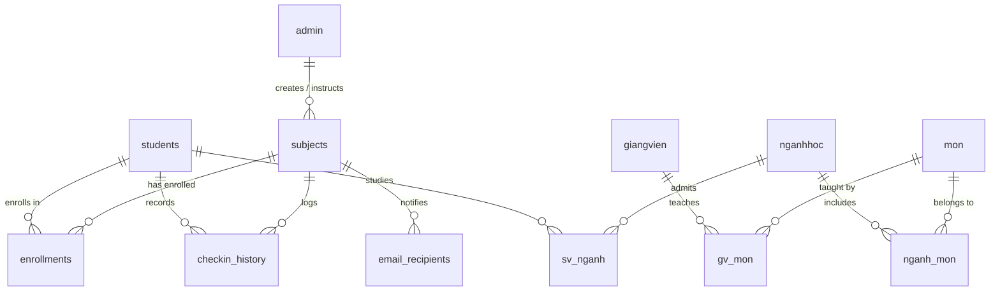

# TÀI LIỆU CẤU TRÚC CƠ SỞ DỮ LIỆU (DATABASE SCHEMA)

**Hệ thống:** Quản lý Điểm danh Bằng Dữ Liệu Khuôn Mặt Của IriTech (PostgreSQL + pgvector)

---

## 1. TỔNG QUAN HỆ THỐNG (SYSTEM OVERVIEW)

Cơ sở dữ liệu bao gồm **6 bảng**, bao gồm có:

  **Core Biometric Attendance System (6 Bảng Chính)**
  Được ánh xạ trực tiếp từ ứng dụng di động Android (`DatabaseHelper.java`), phục vụ điểm danh, lưu trữ vector khuôn mặt (`vector 192 dimensions`), lịch sử điểm danh và gửi báo cáo.
Tất cả các bảng đều tích hợp sẵn 4 trường Metadata chuẩn cho cơ chế **Bi-directional Synchronization (Đồng bộ hai chiều)** giữa SQLite trên Android và PostgreSQL trên Server:

* `uuid`: Mã định dạng toàn cục `VARCHAR(255)` duy nhất.
* `updated_at`: Thời gian cập nhật gần nhất `TIMESTAMP`.
* `deleted_at`: Đánh dấu xóa mềm (Soft Delete) `TIMESTAMP`.
* `seq`: Số thứ tự tăng dần tự động `BIGSERIAL` phục vụ ghi vết thay đổi (Change Log).

---

## 2. CHI TIẾT CÁC BẢNG (TABLE SPECIFICATIONS)

#### 1. Bảng `admin` (Quản trị viên / Giảng viên hệ thống)
Lưu trữ tài khoản admin, mã định danh và thông tin nhận diện sinh trắc học của giảng viên.

| Tên cột | Kiểu dữ liệu | Ràng buộc | Mô tả |
| :--- | :--- | :--- | :--- |
| `admin_id` | `VARCHAR(255)` | **PK** | Mã tài khoản Admin / Giảng viên |
| `email` | `VARCHAR(255)` | `UNIQUE, NOT NULL` | Email đăng nhập |
| `password` | `VARCHAR(255)` | `NOT NULL` | Mật khẩu (đã mã hóa) |
| `full_name` | `VARCHAR(255)` | `NOT NULL` | Họ và tên |
| `date_of_birth` | `VARCHAR(50)` | | Ngày sinh |
| `phone` | `VARCHAR(50)` | | Số điện thoại |
| `gender` | `VARCHAR(50)` | | Giới tính |
| `photo_path` | `TEXT` | | Đường dẫn ảnh chân dung |
| `description` | `TEXT` | | Ghi chú / Mô tả |
| `role` | `VARCHAR(50)` | `DEFAULT 'ADMIN'` | Phân quyền hệ thống |
| `admin_code` | `VARCHAR(100)` | | Mã định danh riêng |
| `reset_token` | `VARCHAR(255)` | | Token khôi phục mật khẩu |
| `expire_at` | `BIGINT` | | Thời gian hết hạn token |
| `is_first_login` | `INT` | `DEFAULT 1` | Cờ đăng nhập lần đầu (1: Có, 0: Không) |
| `has_iris` | `INT` | `DEFAULT 0` | Trạng thái sinh trắc mống mắt |
| `face_embedding` | `VECTOR(192)` | | Vector đặc trưng khuôn mặt (192 chiều) |
| `uuid` | `VARCHAR(255)` | `UNIQUE, NOT NULL` | Mã định danh đồng bộ |
| `updated_at` | `TIMESTAMP` | `DEFAULT CURRENT_TIMESTAMP` | Thời gian cập nhật |
| `deleted_at` | `TIMESTAMP` | | Đánh dấu xóa |
| `seq` | `BIGSERIAL` | `UNIQUE, NOT NULL` | Số Sequence |

#### 2. Bảng `subjects` (Môn học / Học phần)
Quản lý môn học, lịch trình và giảng viên phụ trách.

| Tên cột | Kiểu dữ liệu | Ràng buộc | Mô tả |
| :--- | :--- | :--- | :--- |
| `subject_id` | `VARCHAR(255)` | **PK** | Mã môn học |
| `subject_name` | `VARCHAR(255)` | `NOT NULL` | Tên môn học |
| `time_slot` | `VARCHAR(255)` | | Ca học / Khung giờ học |
| `created_by` | `VARCHAR(255)` | `FK -> admins(admin_id)` | Người tạo môn học |
| `instructor_id` | `VARCHAR(255)` | `FK -> admins(admin_id)` | Giảng viên phụ trách |
| `subject_status` | `VARCHAR(50)` | `DEFAULT 'UNASSIGNED'` | Trạng thái môn học |
| `created_at` | `VARCHAR(50)` | | Ngày tạo môn học |
| `semester_start_date` | `VARCHAR(50)` | | Ngày bắt đầu học kỳ |
| `semester_end_date` | `VARCHAR(50)` | | Ngày kết thúc học kỳ |
| `uuid` | `VARCHAR(255)` | `UNIQUE, NOT NULL` | Mã định danh đồng bộ |
| `updated_at` | `TIMESTAMP` | `DEFAULT CURRENT_TIMESTAMP` | Thời gian cập nhật |
| `deleted_at` | `TIMESTAMP` | | Đánh dấu xóa |
| `seq` | `BIGSERIAL` | `UNIQUE, NOT NULL` | Số Sequence |

#### 3. Bảng `students` (Sinh viên)
Lưu thông tin cá nhân sinh viên và vector khuôn mặt dùng cho nhận diện sinh trắc học.

| Tên cột | Kiểu dữ liệu | Ràng buộc | Mô tả |
| :--- | :--- | :--- | :--- |
| `student_id` | `VARCHAR(255)` | **PK** | Mã số sinh viên (MSSV) |
| `full_name` | `VARCHAR(255)` | | Họ và tên sinh viên |
| `email` | `VARCHAR(255)` | | Địa chỉ Email sinh viên |
| `phone` | `VARCHAR(50)` | | Số điện thoại |
| `photo_path` | `TEXT` | | Đường dẫn ảnh sinh viên |
| `checkin_password` | `VARCHAR(255)` | | Mật khẩu điểm danh dự phòng |
| `face_embedding` | `VECTOR(192)` | | Vector đặc trưng khuôn mặt (192 chiều) |
| `uuid` | `VARCHAR(255)` | `UNIQUE, NOT NULL` | Mã định danh đồng bộ |
| `updated_at` | `TIMESTAMP` | `DEFAULT CURRENT_TIMESTAMP` | Thời gian cập nhật |
| `deleted_at` | `TIMESTAMP` | | Đánh dấu xóa |
| `seq` | `BIGSERIAL` | `UNIQUE, NOT NULL` | Số Sequence |

#### 4. Bảng `enrollments` (Đăng ký học phần)
Bảng trung gian liên kết danh sách sinh viên đăng ký môn học.

| Tên cột | Kiểu dữ liệu | Ràng buộc | Mô tả |
| :--- | :--- | :--- | :--- |
| `student_id` | `VARCHAR(255)` | **PK**, `FK -> students(student_id)` | Mã sinh viên |
| `subject_id` | `VARCHAR(255)` | **PK**, `FK -> subjects(subject_id)` | Mã môn học |
| `enrollment_status` | `VARCHAR(50)` | | Trạng thái đăng ký |
| `uuid` | `VARCHAR(255)` | `UNIQUE, NOT NULL` | Mã định danh đồng bộ |
| `updated_at` | `TIMESTAMP` | `DEFAULT CURRENT_TIMESTAMP` | Thời gian cập nhật |
| `deleted_at` | `TIMESTAMP` | | Đánh dấu xóa |
| `seq` | `BIGSERIAL` | `UNIQUE, NOT NULL` | Số Sequence |

#### 5. Bảng `checkin_history` (Lịch sử điểm danh)
Lưu lại lượt điểm danh thành công của sinh viên trong từng buổi học.

| Tên cột | Kiểu dữ liệu | Ràng buộc | Mô tả |
| :--- | :--- | :--- | :--- |
| `checkin_id` | `SERIAL` | **PK** | Mã lượt điểm danh (Tự tăng) |
| `student_id` | `VARCHAR(255)` | `FK -> students(student_id)` | Mã sinh viên |
| `subject_id` | `VARCHAR(255)` | `FK -> subjects(subject_id)` | Mã môn học |
| `checkin_time` | `VARCHAR(50)` | | Giờ điểm danh (HH:mm:ss) |
| `checkin_date` | `VARCHAR(50)` | | Ngày điểm danh (YYYY-MM-DD) |
| `uuid` | `VARCHAR(255)` | `UNIQUE, NOT NULL` | Mã định danh đồng bộ |
| `updated_at` | `TIMESTAMP` | `DEFAULT CURRENT_TIMESTAMP` | Thời gian cập nhật |
| `deleted_at` | `TIMESTAMP` | | Đánh dấu xóa |
| `seq` | `BIGSERIAL` | `UNIQUE, NOT NULL` | Số Sequence |

#### 6. Bảng `email_recipients` (Danh sách nhận báo cáo email)
Cấu hình danh sách email sẽ tự động nhận báo cáo kết quả điểm danh môn học.

| Tên cột | Kiểu dữ liệu | Ràng buộc | Mô tả |
| :--- | :--- | :--- | :--- |
| `email_id` | `SERIAL` | **PK** | ID email (Tự tăng) |
| `subject_id` | `VARCHAR(255)` | `FK -> subjects(subject_id)` | Mã môn học nhận báo cáo |
| `email_address` | `VARCHAR(255)` | `NOT NULL` | Địa chỉ email người nhận |
| `recipient_name` | `VARCHAR(255)` | | Tên người nhận báo cáo |
| `added_date` | `VARCHAR(50)` | | Ngày thêm email vào danh sách |
| `is_selected` | `BOOLEAN` | `DEFAULT TRUE` | Trạng thái bật/tắt gửi email |
| `uuid` | `VARCHAR(255)` | `UNIQUE, NOT NULL` | Mã định danh đồng bộ |
| `updated_at` | `TIMESTAMP` | `DEFAULT CURRENT_TIMESTAMP` | Thời gian cập nhật |
| `deleted_at` | `TIMESTAMP` | | Đánh dấu xóa |
| `seq` | `BIGSERIAL` | `UNIQUE, NOT NULL` | Số Sequence |

---


## 2. SƠ ĐỒ MỐI QUAN HỆ ERD (MERMAID ER DIAGRAM)



---

## 3. MÃ NGUỒN SQL DDL (POSTGRESQL SCRIPT)

```sql
CREATE EXTENSION IF NOT EXISTS vector;

--6 BẢNG CHÍNH (Từ DatabaseHelper.java)

-- 1. Bảng admin (Quản trị viên / Giảng viên)
CREATE TABLE admin (
    admin_id VARCHAR(255) PRIMARY KEY,
    email VARCHAR(255) UNIQUE NOT NULL,
    password VARCHAR(255) NOT NULL,
    full_name VARCHAR(255) NOT NULL,
    date_of_birth VARCHAR(50),
    phone VARCHAR(50),
    gender VARCHAR(50),
    photo_path TEXT,
    description TEXT,
    role VARCHAR(50) NOT NULL DEFAULT 'ADMIN',
    admin_code VARCHAR(100),
    reset_token VARCHAR(255),
    expire_at BIGINT,
    is_first_login INT DEFAULT 1,
    has_iris INT DEFAULT 0,
    face_embedding VECTOR(192),
    -- Cột đồng bộ hệ thống
    uuid VARCHAR(255) UNIQUE NOT NULL,
    updated_at TIMESTAMP NOT NULL DEFAULT CURRENT_TIMESTAMP,
    deleted_at TIMESTAMP,
    seq BIGSERIAL UNIQUE NOT NULL
);

-- 2. Bảng subjects (Môn học)
CREATE TABLE subjects (
    subject_id VARCHAR(255) PRIMARY KEY,
    subject_name VARCHAR(255) NOT NULL,
    time_slot VARCHAR(255),
    created_by VARCHAR(255) REFERENCES admins(admin_id) ON DELETE SET NULL,
    instructor_id VARCHAR(255) REFERENCES admins(admin_id) ON DELETE SET NULL,
    subject_status VARCHAR(50) NOT NULL DEFAULT 'UNASSIGNED',
    created_at VARCHAR(50),
    semester_start_date VARCHAR(50),
    semester_end_date VARCHAR(50),
    -- Cột đồng bộ hệ thống
    uuid VARCHAR(255) UNIQUE NOT NULL,
    updated_at TIMESTAMP NOT NULL DEFAULT CURRENT_TIMESTAMP,
    deleted_at TIMESTAMP,
    seq BIGSERIAL UNIQUE NOT NULL
);

-- 3. Bảng students (Sinh viên)
CREATE TABLE students (
    student_id VARCHAR(255) PRIMARY KEY,
    full_name VARCHAR(255),
    email VARCHAR(255),
    phone VARCHAR(50),
    photo_path TEXT,
    checkin_password VARCHAR(255),
    face_embedding VECTOR(192),
    -- Cột đồng bộ hệ thống
    uuid VARCHAR(255) UNIQUE NOT NULL,
    updated_at TIMESTAMP NOT NULL DEFAULT CURRENT_TIMESTAMP,
    deleted_at TIMESTAMP,
    seq BIGSERIAL UNIQUE NOT NULL
);

-- 4. Bảng enrollments (Đăng ký học phần)
CREATE TABLE enrollments (
    student_id VARCHAR(255) REFERENCES students(student_id) ON DELETE CASCADE,
    subject_id VARCHAR(255) REFERENCES subjects(subject_id) ON DELETE CASCADE,
    enrollment_status VARCHAR(50),
    PRIMARY KEY (student_id, subject_id),
    -- Cột đồng bộ hệ thống
    uuid VARCHAR(255) UNIQUE NOT NULL,
    updated_at TIMESTAMP NOT NULL DEFAULT CURRENT_TIMESTAMP,
    deleted_at TIMESTAMP,
    seq BIGSERIAL UNIQUE NOT NULL
);

-- 5. Bảng checkin_history (Lịch sử điểm danh)
CREATE TABLE checkin_history (
    checkin_id SERIAL PRIMARY KEY,
    student_id VARCHAR(255) REFERENCES students(student_id) ON DELETE CASCADE,
    subject_id VARCHAR(255) REFERENCES subjects(subject_id) ON DELETE CASCADE,
    checkin_time VARCHAR(50),
    checkin_date VARCHAR(50),
    -- Cột đồng bộ hệ thống
    uuid VARCHAR(255) UNIQUE NOT NULL,
    updated_at TIMESTAMP NOT NULL DEFAULT CURRENT_TIMESTAMP,
    deleted_at TIMESTAMP,
    seq BIGSERIAL UNIQUE NOT NULL
);

-- 6. Bảng email_recipients (Danh sách email nhận báo cáo)
CREATE TABLE email_recipients (
    email_id SERIAL PRIMARY KEY,
    subject_id VARCHAR(255) NOT NULL REFERENCES subjects(subject_id) ON DELETE CASCADE,
    email_address VARCHAR(255) NOT NULL,
    recipient_name VARCHAR(255),
    added_date VARCHAR(50),
    is_selected BOOLEAN DEFAULT TRUE,
    CONSTRAINT unique_subject_email UNIQUE (subject_id, email_address),
    -- Cột đồng bộ hệ thống
    uuid VARCHAR(255) UNIQUE NOT NULL,
    updated_at TIMESTAMP NOT NULL DEFAULT CURRENT_TIMESTAMP,
    deleted_at TIMESTAMP,
    seq BIGSERIAL UNIQUE NOT NULL
);

  ## 4. MÃ NGUỒN DBML (DÙNG CHO DBDIAGRAM.IO)

  Mã định dạng DBML dùng để dán vào các công cụ vẽ sơ đồ online như [dbdiagram.io](https://dbdiagram.io/):
    
    ```dbml
    Table admin {
      admin_id varchar [pk]
      email varchar
      password varchar
      full_name varchar
      date_of_birth varchar
      phone varchar
      gender varchar
      photo_path text
      description text
      role varchar
      admin_code varchar
      reset_token varchar
      expire_at bigint
      is_first_login int
      has_iris int
      face_embedding varchar
      uuid varchar
      updated_at timestamp
      deleted_at timestamp
      seq bigint
    }

    Table subjects {
      subject_id varchar [pk]
      subject_name varchar
      time_slot varchar
      created_by varchar
      instructor_id varchar
      subject_status varchar
      created_at varchar
      semester_start_date varchar
      semester_end_date varchar
      uuid varchar
      updated_at timestamp
      deleted_at timestamp
      seq bigint
    }

    Table students {
      student_id varchar [pk]
      full_name varchar
      email varchar
      phone varchar
      photo_path text
      checkin_password varchar
      face_embedding varchar
      uuid varchar
      updated_at timestamp
      deleted_at timestamp
      seq bigint
    }

    Table enrollments {
      student_id varchar
      subject_id varchar
      enrollment_status varchar
      uuid varchar
      updated_at timestamp
      deleted_at timestamp
      seq bigint
      indexes {
        (student_id, subject_id) [pk]
      }
    }

    Table checkin_history {
      checkin_id int [pk, increment]
      student_id varchar
      subject_id varchar
      checkin_time varchar
      checkin_date varchar
      uuid varchar
      updated_at timestamp
      deleted_at timestamp
      seq bigint
    }

    Table email_recipients {
      email_id int [pk, increment]
      subject_id varchar
      email_address varchar
      recipient_name varchar
      added_date varchar
      is_selected boolean
      uuid varchar
      updated_at timestamp
      deleted_at timestamp
      seq bigint
    }

    Table giangvien {
      magv varchar [pk]
      tengv varchar
      email varchar
      face_embedding varchar
      uuid varchar
      updated_at timestamp
      deleted_at timestamp
      seq bigint
    }

    Table mon {
      mamon varchar [pk]
      tenmon varchar
      uuid varchar
      updated_at timestamp
      deleted_at timestamp
      seq bigint
    }

    Table gv_mon {
      magv varchar
      mamon varchar
      uuid varchar
      updated_at timestamp
      deleted_at timestamp
      seq bigint
      indexes {
        (magv, mamon) [pk]
      }
    }

    Table nganhhoc {
      manganh varchar [pk]
      tennganh varchar
      uuid varchar
      updated_at timestamp
      deleted_at timestamp
      seq bigint
    }

    Table nganh_mon {
      manganh varchar
      mamon varchar
      uuid varchar
      updated_at timestamp
      deleted_at timestamp
      seq bigint
      indexes {
        (manganh, mamon) [pk]
      }
    }

    Table sv_nganh {
      mssv varchar
      manganh varchar
      uuid varchar
      updated_at timestamp
      deleted_at timestamp
      seq bigint
      indexes {
        (mssv, manganh) [pk]
      }
    }

    // Thiết lập mối quan hệ (Foreign Keys)
    Ref: subjects.created_by > admins.admin_id
    Ref: subjects.instructor_id > admins.admin_id
    Ref: enrollments.student_id > students.student_id
    Ref: enrollments.subject_id > subjects.subject_id
    Ref: checkin_history.student_id > students.student_id
    Ref: checkin_history.subject_id > subjects.subject_id
    Ref: email_recipients.subject_id > subjects.subject_id
    Ref: gv_mon.magv > giangvien.magv
    Ref: gv_mon.mamon > mon.mamon
    Ref: nganh_mon.manganh > nganhhoc.manganh
    Ref: nganh_mon.mamon > mon.mamon
    Ref: sv_nganh.mssv > students.student_id
    Ref: sv_nganh.manganh > nganhhoc.manganh
    ```